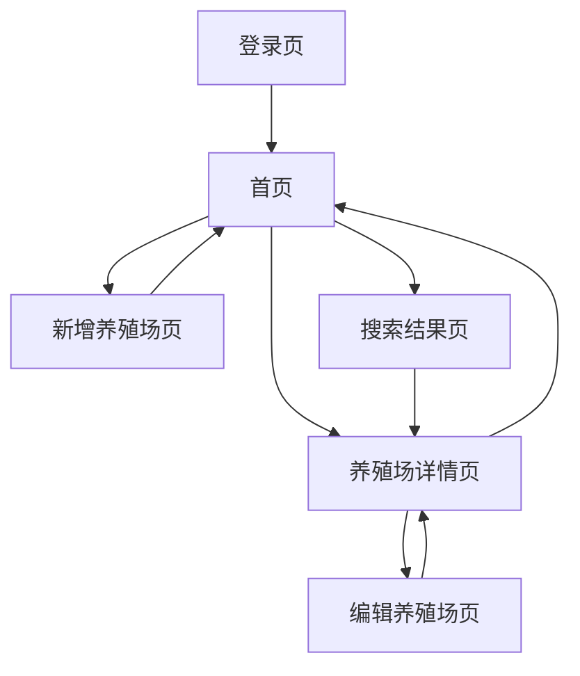

# 养殖场信息管理 App 产品需求文档

## 1. 产品概览

一个专为个人使用的养殖场信息管理应用，用于安卓手机，帮助用户手动录入、管理和查找养殖场信息，提高信息管理效率。

- 解决养殖场信息分散、查找困难的问题，提供集中化的信息管理平台
- 支持图片和文件上传，便于存储养殖场相关的资料
- 提供简单直观的操作界面，适合非技术用户使用

## 2. 核心功能

### 2.1 功能模块

我们的养殖场信息管理 App 包含以下主要页面：

1. **登录页**：用户认证入口
2. **首页**：养殖场信息概览
3. **养殖场详情页**：查看和编辑养殖场详细信息
4. **新增养殖场页**：创建新的养殖场记录
5. **搜索结果页**：展示搜索结果

### 2.2 页面详情

| 页面名称 | 模块名称 | 功能描述 |
|---------|---------|----------|
| 登录页 | 登录模块 | 用户输入用户名和密码进行登录，支持记住密码功能 |
| 登录页 | 注册模块 | 新用户注册账号，设置用户名和密码（暂时关闭，后续可能开放） |
| 首页 | 养殖场列表 | 展示所有养殖场信息，支持下拉刷新和上拉加载更多 |
| 首页 | 搜索功能 | 提供搜索框，支持按养殖场名称、地址等条件搜索 |
| 首页 | 新增按钮 | 点击进入新增养殖场页面 |
| 养殖场详情页 | 基本信息 | 展示养殖场名称、地址、类型、规模等基本信息 |
| 养殖场详情页 | 图片展示 | 展示上传的养殖场图片，支持点击放大查看 |
| 养殖场详情页 | 文件列表 | 展示上传的相关文件，支持下载和分享 |
| 养殖场详情页 | 编辑按钮 | 点击进入编辑模式，修改养殖场信息 |
| 养殖场详情页 | 删除按钮 | 删除当前养殖场记录（需确认） |
| 新增养殖场页 | 信息填写 | 填写养殖场基本信息，包括名称、地址、类型、规模等 |
| 新增养殖场页 | 图片上传 | 上传养殖场相关图片，支持多张上传 |
| 新增养殖场页 | 文件上传 | 上传相关文件，如营业执照、资质证书等 |
| 新增养殖场页 | 保存按钮 | 保存新建的养殖场信息 |
| 搜索结果页 | 结果列表 | 展示符合搜索条件的养殖场信息 |
| 搜索结果页 | 筛选功能 | 支持按不同条件筛选搜索结果 |

## 3. Core Process

### 主要用户操作流程

**用户登录流程：**
用户打开应用 → 输入用户名和密码 → 点击登录 → 验证成功后进入首页

**新增养殖场流程：**
用户在首页点击「新增」按钮 → 进入新增养殖场页面 → 填写养殖场信息 → 上传图片和文件 → 点击「保存」 → 保存成功后返回首页

**查看/编辑养殖场流程：**
用户在首页点击某个养殖场 → 进入养殖场详情页 → 查看详细信息 → 点击「编辑」按钮 → 修改信息 → 点击「保存」 → 保存成功后返回详情页

**搜索养殖场流程：**
用户在首页输入搜索关键词 → 点击搜索 → 进入搜索结果页 → 查看搜索结果 → 点击某个结果进入详情页

## 4. 用户接口设计

### 4.1 设计风格

- **主色调**：绿色系（#4CAF50），代表农业和自然
- **辅助色**：白色（#FFFFFF）、浅灰色（#F5F5F5）、深灰色（#333333）
- **按钮样式**：圆角矩形按钮，主操作按钮使用主色调
- **字体**：无衬线字体，标题 18px，正文 14px，辅助文字 12px
- **布局风格**：卡片式布局，清晰的视觉层次
- **图标风格**：简洁的线性图标，保持一致性

### 4.2 页面设计概览

| 页面名称 | 模块名称 | UI元素 |
|---------|---------|--------|
| 登录页 | 登录模块 | 应用Logo、用户名输入框、密码输入框、登录按钮、注册链接 |
| 首页 | 养殖场列表 | 顶部搜索栏、新增按钮、养殖场卡片列表（包含名称、地址、简要信息） |
| 养殖场详情页 | 基本信息 | 顶部返回按钮、养殖场名称、信息卡片（地址、类型、规模等）、图片网格、文件列表、编辑和删除按钮 |
| 新增养殖场页 | 信息填写 | 顶部返回和保存按钮、表单输入框（名称、地址、类型、规模等）、图片上传区域、文件上传区域 |
| 搜索结果页 | 结果列表 | 顶部搜索栏、筛选按钮、搜索结果列表（与首页列表样式一致） |

### 4.3 自适应

- **设计理念**：移动优先，专为安卓手机设计
- **屏幕适配**：支持主流安卓手机屏幕尺寸
- **操作方式**：优化触摸操作，按钮和可点击区域大小适合手指点击
- **字体大小**：确保在不同屏幕尺寸下文字清晰可读
